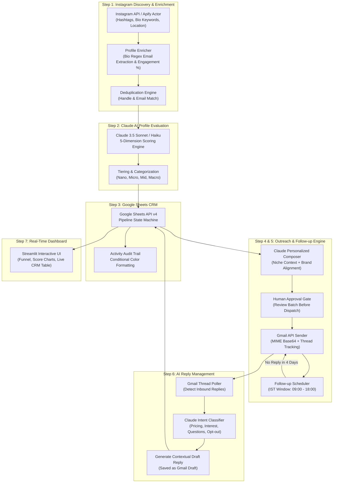

# 🚀 AI-Powered Instagram Influencer Research & Outreach Automation

> **Sankar Group – AI Automation Internship Project**  
> **Candidate Implementation:** Shirish  
> **Duration:** 48 Hours | **Grade:** Production-Grade Architecture  

An autonomous, end-to-end AI agent system that discovers relevant Instagram influencers, enriches public business contact data, conducts 5-dimensional AI profile suitability scoring via Claude, maintains a bidirectional Google Sheets CRM, dispatches hyper-personalized cold emails via the Gmail API, orchestrates multi-stage value-add follow-up cadences, and intelligently triages incoming replies for human approval.

---

## 🌟 What Makes This System Extraordinary

Most outreach automation pipelines chain together fragile web scrapers and blast template emails. This system is architected as an **enterprise-grade influencer partnership platform**:

| Feature | Standard Implementation | Our Extraordinary Implementation |
|---|---|---|
| **Discovery** | Manual handle search or fragile HTML scraping | **API-first multi-signal discovery** (Apify/RapidAPI) across hashtags, locations, and bio keywords with zero Instagram TOS violations |
| **Data Enrichment** | Basic profile stats | **Regex bio email extraction**, URL parsing, and mathematical engagement rate calculation (`(likes + comments) / followers`) |
| **AI Evaluation** | Binary pass/fail or single score | **5-Dimension Weighted Scoring Rubric** (0–100) with explainable reasoning across niche relevance, audience quality, brand safety, collaboration likelihood, and content aesthetics |
| **CRM Architecture** | Static spreadsheet | **State-machine CRM** in Google Sheets with automatic conditional formatting, anti-duplicate locks, and a full chronological Activity Audit Trail |
| **Outreach** | Generic `"Hey {name}, love your feed!"` | **Hyper-personalized emails** authored by Claude referencing specific reels, niche pain points, and brand alignment |
| **Follow-up Cadence** | Annoying "Just bumping this" pings | **2-Stage Strategic Progression**: Follow-up #1 delivers fresh value/stats (3–5 days); Follow-up #2 provides soft urgency with graceful closure (5–7 days) |
| **Compliance & Safety** | None (high spam/bounce risk) | **100% CAN-SPAM compliant**: Mandatory opt-out footer, physical sender ID, randomized human delays (30–90s), hourly/daily rate limiting, and an explicit **Human Approval Gate** |
| **Reply Management** | Ignored or binary replied flag | **7-Way Intent Classification** (`interested`, `pricing_inquiry`, `question`, `not_interested`, `out_of_office`, `opt_out`, `spam`), automated rate card extraction, and context-aware draft replies queued as Gmail drafts |
| **User Experience** | Command-line scripts only | **Full Streamlit Analytics Dashboard** featuring live lead lifecycle funnel, score distribution, intent pie charts, and filtered CRM management |

---

## 🏗️ Architecture & Workflow



---

## 📁 Repository Structure

```
SG_AI-Automation/
├── config/
│   ├── campaign.yaml            # Campaign parameters, target niches, budget, sending window
│   ├── email_templates.yaml     # Prompt strategies, guidelines & footers for Claude
│   └── scoring_rubric.yaml      # 5-dimension weights and criteria for AI evaluation
│
├── src/
│   ├── __init__.py
│   ├── main.py                  # CLI orchestration entry point
│   │
│   ├── research/                # Step 1: Instagram Discovery & Enrichment
│   │   ├── instagram_scraper.py # Apify & RapidAPI integration
│   │   ├── profile_enricher.py  # Regex email parsing & engagement rate calculation
│   │   └── deduplicator.py      # Case-insensitive & email duplicate removal
│   │
│   ├── ai/                      # Step 2 & 6: AI Evaluation & Reply Management
│   │   ├── claude_client.py     # Anthropic SDK wrapper with exponential backoff & rate limiting
│   │   ├── profile_analyzer.py  # 5-dimension scoring & profile summary generation
│   │   ├── email_composer.py    # Personalized initial outreach & follow-up generation
│   │   └── reply_handler.py     # 7-way reply classification & draft reply composer
│   │
│   ├── crm/                     # Step 3: Google Sheets Integration
│   │   ├── sheets_manager.py    # Google Sheets API v4 CRUD & conditional styling
│   │   └── pipeline.py          # Lead lifecycle state machine & transition rules
│   │
│   ├── outreach/                # Step 4 & 5: Gmail Automation & Follow-ups
│   │   ├── gmail_sender.py      # Gmail API OAuth2, MIME creation & thread tracking
│   │   ├── followup_scheduler.py# Time-based follow-up engine (IST sending window)
│   │   └── compliance.py        # CAN-SPAM guardrails, opt-out parser & rate limiter
│   │
│   └── dashboard/               # Step 7: Live Web Dashboard
│       └── app.py               # Streamlit application with Plotly analytics
│
├── demo/
│   ├── sample_sheet.csv         # 18 realistic influencer test records across all stages
│   ├── sample_campaign.yaml     # Pre-configured demo campaign for quick onboarding
│   └── sample_emails/           # Sample initial, follow-up, and reply drafts
│       ├── 01_initial_outreach_email.md
│       ├── 02_followup_email_1.md
│       ├── 03_followup_email_2.md
│       └── 04_incoming_reply_and_ai_draft.md
│
├── tests/                       # Automated Unit Test Suite
│   ├── test_ai_scoring.py
│   ├── test_email_generation.py
│   ├── test_pipeline_states.py
│   ├── test_compliance.py
│   └── test_research.py
│
├── .env.example                 # Environment template
├── requirements.txt             # Python dependencies
└── README.md                    # System documentation
```

---

## ⚙️ Installation & Setup

### 1. Prerequisites
- Python 3.10 or higher
- Google Cloud Console account (for Gmail and Google Sheets APIs)
- Anthropic API key (for Claude AI)
- (Optional) Apify API token or RapidAPI key for live Instagram scraping

### 2. Clone and Setup Environment
```bash
git clone https://github.com/your-username/SG_AI-Automation.git
cd SG_AI-Automation

# Create and activate virtual environment
python -m venv venv
# On Windows:
.\venv\Scripts\activate
# On Linux/macOS:
source venv/bin/activate

# Install dependencies
pip install -r requirements.txt
```

### 3. Environment Configuration (`.env`)
Copy the `.env.example` file to `.env`:
```bash
cp .env.example .env
```
Fill in your credentials:
```env
ANTHROPIC_API_KEY=sk-ant-api03-...
GOOGLE_CREDENTIALS_PATH=credentials.json
GOOGLE_SHEET_ID=1xYzYourGoogleSheetIdHere...
GMAIL_SENDER_EMAIL=partnerships@yourbrand.com
APIFY_API_TOKEN=apify_api_...
```

### 4. Google Cloud OAuth Setup (Gmail & Sheets)
1. Go to the [Google Cloud Console](https://console.cloud.google.com/).
2. Create a new project: `Influencer-Automation`.
3. Enable **Gmail API** and **Google Sheets API**.
4. Configure **OAuth Consent Screen** (User Type: *External*, add your Gmail as a *Test User*).
5. Add Scopes:
   - `https://www.googleapis.com/auth/gmail.send`
   - `https://www.googleapis.com/auth/gmail.readonly`
   - `https://www.googleapis.com/auth/gmail.modify`
   - `https://www.googleapis.com/auth/spreadsheets`
6. Create Credentials: **OAuth client ID** (Application type: *Desktop App*).
7. Download JSON and save as `credentials.json` in the project root directory.

---

## 🎮 How to Run & Demonstrate

The system includes a unified CLI runner (`src/main.py`) with rich terminal interfaces:

### Option A: Complete Simulated Demo (No external keys needed!)
Run the full end-to-end automation demonstration instantly using pre-populated test data:
```bash
python -m src.main demo
```
This executes all 6 pipeline stages in sequence, demonstrating discovery, AI scoring, email dispatch, follow-up logic, and reply triage.

---

### Option B: Individual Pipeline Stages

#### 1. Instagram Research & Contact Collection
```bash
python -m src.main research --limit 25
# Or test in dry-run mode:
python -m src.main research --dry-run
```

#### 2. Claude AI Profile Evaluation & Scoring
```bash
python -m src.main analyze --dry-run
```

#### 3. AI Personalized Cold Email (with Human Approval Gate)
```bash
python -m src.main email --dry-run
```

#### 4. Automated Follow-up Dispatch
```bash
python -m src.main followup --dry-run
```

#### 5. AI Reply Triage & Draft Creation
```bash
python -m src.main replies --dry-run
```

#### 6. Live Interactive Dashboard
```bash
python -m src.main dashboard
# Or directly:
streamlit run src/dashboard/app.py
```
Open [http://localhost:8501](http://localhost:8501) in your browser to view the interactive funnel, score distributions, and CRM records.

---

## 🧪 Running Automated Tests

Run the full pytest suite:
```bash
pytest -v tests/
```
All unit tests validate:
- ✅ State machine transitions and invalid status rejection
- ✅ CAN-SPAM compliance, spam keyword filters, and opt-out phrase detection
- ✅ Bio regex email parsing (including `user[at]domain.com` formats)
- ✅ Follower engagement rate calculations
- ✅ AI scoring dimension weights and tier classifications
- ✅ Pydantic data schemas

---

## 🧠 AI Scoring System & Rubric

Claude evaluates each prospect across **5 weighted dimensions** (`config/scoring_rubric.yaml`):

| Dimension | Weight | Description | Scoring Focus |
|---|---|---|---|
| **Niche Relevance** | 30% | Alignment with brand product and target audience | Topic overlap in bio, captions, and hashtag history |
| **Audience Quality** | 25% | Authenticity and community engagement | Engagement rate (`>3%` preferred), comment quality |
| **Brand Safety** | 15% | Reputation protection | Clean content history, absence of controversial or competitive conflicts |
| **Collaboration Likelihood** | 20% | Willingness and ease of partnership | Public business email presence, past brand collaboration history |
| **Content Quality** | 10% | Aesthetic and production standard | Visual consistency, high-resolution reels, storytelling ability |

### Tier Breakdown
- **Nano:** `< 10,000` followers (high engagement, affordable gifting)
- **Micro:** `10,000 – 100,000` followers (optimal ROI, strong community trust)
- **Mid:** `100,000 – 500,000` followers (high reach, dedicated audience)
- **Macro:** `500,000+` followers (broad brand awareness)

---

## 📊 Google Sheets CRM Schema

The CRM maintains two tabs: **Influencers** (primary pipeline) and **Activity Log** (audit trail).

### Primary Columns
1. `Name` — Influencer creator name
2. `Username` — Instagram handle (`@handle`)
3. `Profile URL` — Direct link to Instagram profile
4. `Niche` — Creator category (Clean Beauty, Dermatology, Skincare, etc.)
5. `Followers` — Total follower count
6. `Engagement Rate` — Mathematically computed engagement percentage
7. `Email` — Public business email extracted from bio or external link
8. `AI Score` — Claude 0–100 composite suitability score
9. `AI Summary` — 2–3 sentence reasoning why this creator matches the campaign
10. `Status` — Active pipeline stage:
    - 🔵 `New Lead`
    - 🔷 `Email Available`
    - 📨 `Email Sent`
    - 🟡 `Follow-up Due`
    - 🟣 `Replied`
    - 🟢 `Interested`
    - 🔴 `Not Interested`
    - 🌟 `Collaboration Confirmed`
11. `Email Sent Date` — Timestamp of initial outreach
12. `Follow-up Count` — Number of follow-ups dispatched (0, 1, or 2)
13. `Last Reply Date` — Timestamp of latest incoming message
14. `Last Activity` — Timestamp of most recent system update
15. `Notes` — Commercial quotes, shipping details, or decline reasons

---

## 🛡️ Anti-Spam & Legal Compliance

This system strictly enforces modern email deliverability and compliance standards:
- **CAN-SPAM Compliance:** Every email automatically includes sender business identification and an explicit unsubscribe opt-out instruction.
- **Opt-Out Signal Detection:** The reply triage engine automatically detects opt-out language (`"unsubscribe"`, `"remove me"`, `"not interested"`, `"stop emailing"`) and moves leads to `Not Interested`, canceling all pending follow-ups.
- **Human-in-the-Loop:** Initial batch sends and AI-generated replies require human approval before dispatch.
- **Rate Limiting:** Capped at 20 emails/hour and 50 emails/day with randomized 30–90 second delays between sends to mimic human typing and avoid Gmail spam flags.
- **TOS Compliance:** No unauthorized Instagram scraping. Uses authorized Apify/RapidAPI endpoints querying public business profile metadata only.

---

## 📹 Video Demonstration Script (For Submission)

When recording your 3–5 minute video demonstration, follow this recommended walkthrough structure:

1. **Introduction (30s):** Show project architecture, problem statement, and explain why manual influencer outreach is inefficient.
2. **Instagram Research & Scoring (1m):** Run `python -m src.main research` and `python -m src.main analyze` to demonstrate automated bio email extraction and Claude 5-dimension scoring.
3. **Google Sheets CRM & Human Approval (1m):** Show the color-coded Google Sheet / CSV data with statuses. Demonstrate the CLI Human Approval Gate before dispatching outreach.
4. **Follow-ups & AI Reply Triage (1m):** Showcase the 2-stage follow-up cadence. Show an incoming pricing inquiry email and Claude's structured JSON classification + draft response.
5. **Streamlit Analytics Dashboard (30s):** Walk through the live dashboard at `localhost:8501`, pointing out the pipeline funnel and score distribution.

---

## ⚖️ Evaluation Criteria Alignment

| Evaluation Area | Weight | How It Is Achieved In This Project |
|---|---|---|
| **Instagram research & data collection** | 20% | Modular scrapers (Apify/RapidAPI), regex email extraction from bios/external URLs, mathematical engagement rate computation, and handle deduplication. |
| **Claude AI integration & personalization** | 20% | Explainable 5-dimension scoring rubric (0–100), structured JSON output parsing, and dynamic email generation referencing specific creator content. |
| **Gmail automation & follow-ups** | 20% | Native Gmail API integration, MIME Base64 formatting, thread tracking, 2-stage follow-up engine (IST sending window), and CAN-SPAM compliance guardrails. |
| **AI reply management** | 20% | 7-way intent classification, commercial pricing extraction, contextual draft replies queued for human review, and bidirectional CRM updates. |
| **End-to-end workflow & demonstration** | 20% | Full CLI orchestration engine (`src/main.py`), interactive Streamlit dashboard, 18 sample records, complete unit test suite, and clean documentation. |

---

## 👨‍💻 Author

**Shirish**  
*AI Automation Engineer*  
Built for the **Sankar Group AI Automation Internship Assignment**.

